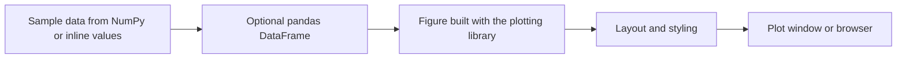

# Data Visualization with Python


A set of Python scripts demonstrating static and interactive data visualization with Matplotlib, Bokeh, and Plotly, including grouped bar charts, annotated line graphs, histograms, 3D plots, time series, and geographic maps.

## Overview

The repository is organized by visualization library. Each script is self-contained, generates or defines its own sample data, and produces one or more finished charts. No external datasets are required, so every example can run immediately after the dependencies are installed.

## Key Features

- Grouped bar chart with per-bar data labels and gridlines (Matplotlib)
- Multi-line graph with text and arrow annotations and a styled legend (Bokeh)
- Grid layout combining line, scatter, and histogram plots, with a probability density overlay (Bokeh)
- 3D scatter plot with color mapping and 3D surface plot with contours (Plotly)
- Time series plot combining a line trace with volatility bars (Plotly)
- Geographic scatter map with population-based marker size, color, and hover data (Plotly)

## Scripts

| Library | Script | Visualization | Output |
| --- | --- | --- | --- |
| Matplotlib | [`matplotlib/bar_chart.py`](matplotlib/bar_chart.py) | Student marks compared across three subjects | Plot window |
| Bokeh | [`Bokeh/line_graph_with_annotations.py`](Bokeh/line_graph_with_annotations.py) | Sine and cosine lines with annotations | `bokeh_enhanced_line_graph.html` |
| Bokeh | [`Bokeh/multiple_plots_bokeh.py`](Bokeh/multiple_plots_bokeh.py) | Line, scatter, and histogram grid | `bokeh_enhanced_plots.html` |
| Plotly | [`plotly/3d_plots.py`](plotly/3d_plots.py) | 3D scatter and 3D surface figures | Browser (two figures) |
| Plotly | [`plotly/map_visualization.py`](plotly/map_visualization.py) | City populations on a world map | Browser |
| Plotly | [`plotly/time_series_plot.py`](plotly/time_series_plot.py) | 200-day series with volatility bars | Browser |

## Technology Stack

| Component | Technology | Role |
| --- | --- | --- |
| Language | Python 3 | Scripting |
| Static charts | Matplotlib | Bar chart |
| Interactive charts | Bokeh | HTML-based plots and layouts |
| Interactive charts | Plotly | 3D plots, maps, and time series |
| Numerical computing | NumPy | Sample data and mathematical functions |
| Data handling | pandas | Tabular data for Bokeh and Plotly |

`requirements.txt` also lists Seaborn. The current scripts do not import it.

## Architecture and Workflow



## Project Structure

```text
DataVisualizationWithPython/
├── Bokeh/
│   ├── line_graph_with_annotations.py
│   └── multiple_plots_bokeh.py
├── matplotlib/
│   └── bar_chart.py
├── plotly/
│   ├── 3d_plots.py
│   ├── map_visualization.py
│   └── time_series_plot.py
├── requirements.txt
└── README.md
```

## Installation and Setup

### Prerequisites

- Python 3 with `pip`
- A web browser for the Bokeh and Plotly output

### Install

```bash
git clone https://github.com/Partha-Shankar/DataVisualizationWithPython.git
cd DataVisualizationWithPython
python -m venv venv
```

Activate the virtual environment:

```bash
source venv/bin/activate      # Linux and macOS
venv\Scripts\activate         # Windows
```

Install the dependencies:

```bash
pip install -r requirements.txt
```

## Usage

Run any script from the repository root:

```bash
python matplotlib/bar_chart.py
python Bokeh/multiple_plots_bokeh.py
python plotly/time_series_plot.py
```

Matplotlib opens a plot window. Plotly opens each figure in the default browser. Bokeh writes an HTML file to the current working directory and opens it in the browser.

## Technical Implementation

### Matplotlib

`bar_chart.py` offsets bar positions with a NumPy index to group three subjects per student, then adds a value label above each bar.

### Bokeh

`line_graph_with_annotations.py` adds `Label` and `Arrow` layout annotations and customizes the legend's title, font, border, and background. `multiple_plots_bokeh.py` builds its histogram with `numpy.histogram` and `quad` glyphs, overlays a normal probability density curve, and arranges the plots with `gridplot`.

### Plotly

`3d_plots.py` uses `Scatter3d` with a Viridis color scale and `Surface` with a Plasma color scale, projected contours, and a custom camera position. `map_visualization.py` uses `plotly.express.scatter_geo` with customized coastlines, land, and ocean colors. `time_series_plot.py` combines a `Scatter` line trace with an overlaid `Bar` trace on a shared time axis.

### Sample Data

All data is synthetic or illustrative. Randomized examples set a fixed NumPy seed of 42, so they produce the same chart on each run. The population figures in the map example are sample values for demonstration.
